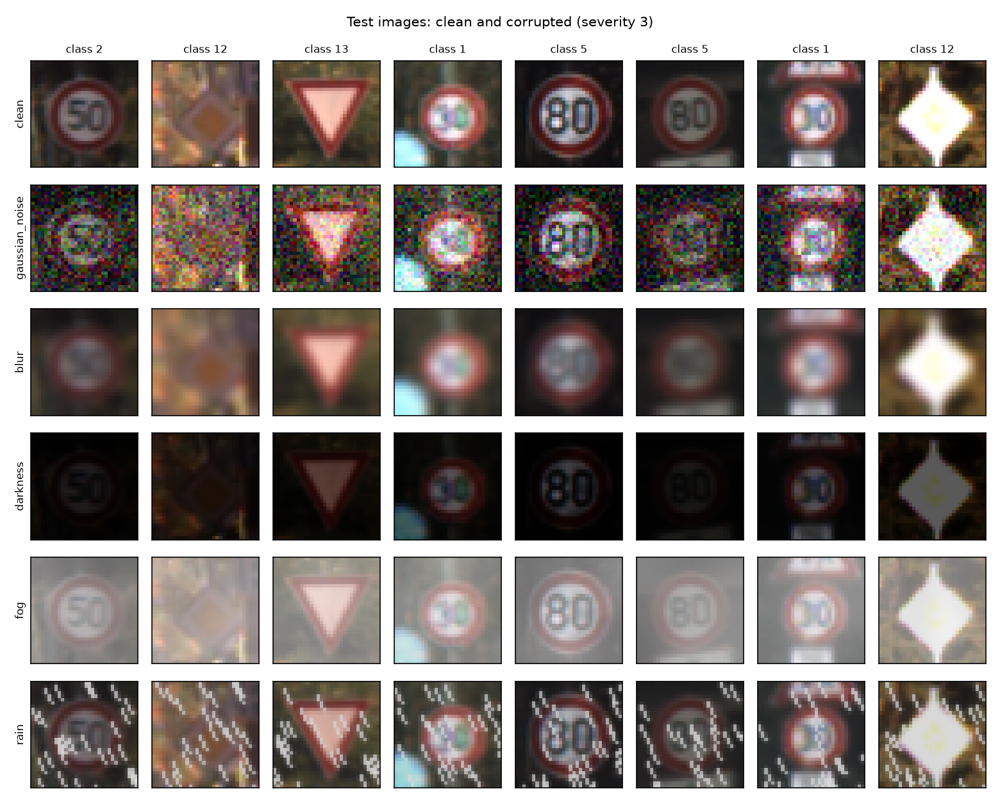
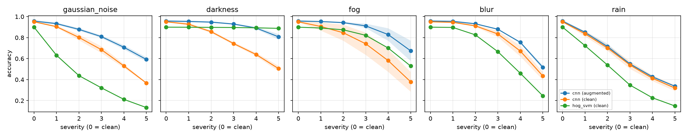
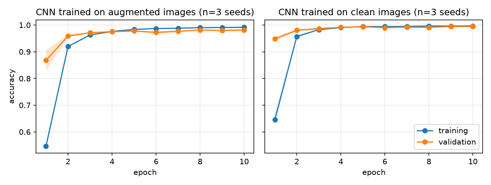

# Traffic-sign recognition under bad weather: a robustness evaluation

[](https://github.com/lblovelb/traffic-sign-robustness/actions/workflows/ci.yml)

*A portfolio project by Love Barrehag, built to show how I approach applied ML
prototyping: a clear question, a fair baseline, robustness metrics and honest
conclusions.*

**Question:** a traffic-sign classifier scores ~95% on clean images. What
happens when the camera sees fog, rain, darkness, blur or sensor noise? And
does training on degraded images fix it, even for conditions the model never saw?

This is a small, reproducible prototype in the style of applied automotive AI
work. It builds a model, evaluates it against an existing solution with clear
metrics, stress-tests its robustness on simulated data, and judges feasibility.



## Key findings

1. **The CNN beats the classical baseline.** It reaches 95.1% on clean images
   against 90.0% for HOG + SVM, and it degrades less on average (68% vs 60%
   across all corruptions).
2. **Augmentation is free on clean data and strong on what it was trained on.**
   Clean accuracy stays the same (95.7%), while accuracy on the corruptions seen
   in training rises from 69% to 85%. At maximum darkness it goes from 51% to 81%.
3. **The robustness does not generalise well.** On corruptions never seen in
   training, accuracy only moves from 66% to 69%. Blur improves a little and rain
   does not improve at all. Robustness has to be targeted at the conditions a
   vehicle will actually meet.
4. **The old method has one clear strength.** HOG + SVM barely notices darkness
   (89% even at the worst level) because HOG normalises away brightness, so it
   beats the clean-trained CNN there. It collapses under sensor noise (13%).
5. **Both models are fast enough for real time.** Each needs under 1 ms per image
   on a laptop CPU, well inside a ~33 ms per-frame budget at 30 fps.

## Experimental design

| Condition | Train on | Test on | Answers |
|---|---|---|---|
| **Baseline** | clean | clean | How good are the models normally? |
| **Shift** | clean | corrupted (5 types × 5 severities) | Where and how fast do they break? |
| **Mitigation** | partly corrupted (noise, darkness, fog) | corrupted | Does augmentation help on *seen* corruptions, and on *unseen* ones (blur, rain)? |

- **Models:**
  - **CNN** (TensorFlow/Keras): a small convolutional network with about 600k
    parameters. It learns which visual patterns matter directly from the pixels.
  - **HOG + linear SVM**: the baseline that stands in for "the existing
    solution". HOG (Histogram of Oriented Gradients) turns each image into a
    description of its edge directions, which is stable under small shifts and
    lighting changes. A linear SVM then separates the 43 classes. This kind of
    hand-crafted pipeline was the standard approach for sign and pedestrian
    recognition before deep learning.
- **Data:** [GTSRB](https://benchmark.ini.rub.de/gtsrb_news.html), 43 classes,
  26,640 training and 12,630 test images, resized to 32×32.
- **Metrics:** accuracy, macro-F1, latency per image and model size.
- **Reliability:** 3 seeds, reported as mean ± std. All models are tested on
  identical corrupted images (fixed corruption seed).
- **Tracking:** every run is logged in MLflow, including per-epoch learning
  curves. Every evaluation is also a row in `results/results.csv`.

## Results

Accuracy, mean ± std over 3 seeds.

| Model | Trained on | Clean | All corrupted | Seen in training | Never seen | ms / image | Size (MB) |
|---|---|---|---|---|---|---|---|
| HOG + SVM | clean | 0.900 | 0.604 | 0.669 | 0.508 | 0.91 | 0.6 |
| CNN | clean | 0.951 ± 0.004 | 0.681 ± 0.032 | 0.694 ± 0.038 | 0.661 ± 0.025 | 0.29 | 2.4 |
| CNN | augmented | **0.957 ± 0.011** | **0.787 ± 0.011** | **0.851 ± 0.017** | **0.692 ± 0.007** | 0.29 | 2.4 |

*Seen* means noise, darkness and fog, which were used for augmentation.
*Never seen* means blur and rain. HOG + SVM has no spread because it is fully
deterministic, so the seed does not change it.

**Accuracy at the worst severity (5):**

| Model | Noise | Darkness | Fog | Blur *(unseen)* | Rain *(unseen)* |
|---|---|---|---|---|---|
| HOG + SVM | 0.13 | **0.89** | 0.53 | 0.25 | 0.15 |
| CNN (clean) | 0.37 | 0.51 | 0.38 | 0.44 | 0.32 |
| CNN (augmented) | **0.59** | 0.81 | **0.67** | **0.52** | **0.34** |



**Learning curves** (mean ± std over 3 seeds). Training and validation accuracy
track each other and level off near 1.0, so 10 epochs is enough and the model
is not overfitting. Validation starts higher than training in epoch 1 because
training accuracy is averaged *during* the epoch (with dropout active), while
validation is measured at its end.



## Found during development

Two bugs showed up in the learning curves logged to MLflow. Both are fixed,
and each fix is a separate commit:

- **Validation data contained classes that were never trained on.** GTSRB is
  stored sorted by class, and Keras' `validation_split` takes the *last* 10% of
  the data, so the last classes never reached training. Validation accuracy was
  0.5%, below chance. The fix was to shuffle once with a fixed seed.
- **Train/inference mismatch caused by BatchNorm.** The model reached 98%
  training accuracy but ~5% validation accuracy. With the default momentum
  (0.99), BatchNorm's running statistics lagged far behind the weights during
  short training runs, so the network behaved differently at inference. With
  momentum 0.9, validation tracks training, and clean test accuracy went from
  4.8% to 87% in the quick run.

## Run it

```bash
conda create -n tsr -c conda-forge python=3.11 -y && conda activate tsr
pip install -r requirements.txt
pip install -e .

pytest                              # tests (no TensorFlow needed)
python -m tsr.preview               # save example images to results/
python -m tsr.experiment --quick    # smoke test, a few minutes
python -m tsr.experiment            # full experiment, ~1 hour on a laptop CPU
mlflow ui --backend-store-uri sqlite:///mlflow.db   # browse runs at http://127.0.0.1:5000
```

The dataset (~300 MB) downloads automatically into `data/` on the first run.

**Continuous integration:** on every push, GitHub Actions runs `ruff`
(lint and formatting) and the `pytest` suite (see `.github/workflows/ci.yml`).
The tests cover the corruptions, metrics and reporting. They run without
TensorFlow, which keeps CI fast.

## Project layout

```
src/tsr/
  corruptions.py   simulated fog, rain, darkness, blur, noise (NumPy, seeded)
  data.py          GTSRB download + cache
  models.py        CNN and HOG+SVM
  metrics.py       accuracy, macro-F1, latency
  experiment.py    runs all conditions, logs to MLflow + CSV
  report.py        summary table + robustness plot
  preview.py       example images of the corruptions
configs/experiment.yaml   every experimental setting in one place
tests/                    unit tests, run in CI on every push
notes/                    project vault: decisions, experiment log, analysis
```

## How this project was built: AI-assisted workflow

I built this with Claude Code. Claude generated the initial scaffold (the first
commit). I then ran the experiments, found and fixed the bugs above, and
interpreted the results. The repo also contains the configuration I use to work
with Claude as a team of specialised agents, versioned like code:

- `CLAUDE.md`: project rules that every agent follows, for example never
  tuning on the test set and reporting every number as mean ± std over seeds.
- `.claude/agents/`
  - `code-reviewer`: a read-only reviewer with a dedicated
    *experimental-validity* pass that checks for data leakage, seeds and unseen
    corruptions leaking into training. Findings are confidence-scored, and
    anything below 80/100 is dropped.
  - `experiment-runner`: runs the smoke test before the full run and logs
    each run.
  - `results-analyst`: writes conclusions that are backed by the numbers and
    states the limitations.
- `.claude/skills/run-robustness-eval`: chains the agents in order: lint/test,
  then review, then run, then analyse.
- `notes/`: an Obsidian-compatible vault that serves as long-term memory
  across sessions.

## Background

The design mirrors my bachelor thesis, *Empirical evaluation of English-trained
machine learning models for phishing email detection in a Scandinavian context*
(Linnaeus University, 2026). The thesis measured how models degrade under a
distribution shift (language) and whether a mitigation (machine translation)
recovers the lost performance. The answer there was similar to findings 2 and 3
here: the mitigation helped, but it did not close the gap.

## Limitations

- The corruptions are synthetic. They approximate weather and are not real
  recordings of it.
- GTSRB contains cropped signs, so this covers classification only and not
  detection in full scenes.
- Validation accuracy (~99%) is optimistic. GTSRB training images come in tracks
  of near-identical frames of the same physical sign, and a random split puts
  frames from the same track in both training and validation. The test set is
  separate, so the test numbers above are not affected.
- Results come from a single dataset, a single image resolution and 3 seeds.
