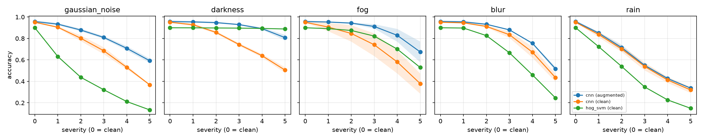

# Results summary

Accuracy, mean ± std over seeds. *seen* = corruptions used in augmentation, *unseen* = never shown during training.

| model   | train     | clean         | all_corrupted   | seen          | unseen        |   latency_ms |   size_mb |
|:--------|:----------|:--------------|:----------------|:--------------|:--------------|-------------:|----------:|
| cnn     | augmented | 0.957 ± 0.011 | 0.787 ± 0.011   | 0.851 ± 0.017 | 0.692 ± 0.007 |        0.287 |      2.38 |
| cnn     | clean     | 0.951 ± 0.004 | 0.681 ± 0.032   | 0.694 ± 0.038 | 0.661 ± 0.025 |        0.285 |      2.38 |
| hog_svm | clean     | 0.900 ± 0.000 | 0.604 ± 0.000   | 0.669 ± 0.000 | 0.508 ± 0.000 |        0.905 |      0.61 |

## Accuracy per corruption (mean over severities)

| model   | train     |   blur |   darkness |   fog |   gaussian_noise |   rain |
|:--------|:----------|-------:|-----------:|------:|-----------------:|-------:|
| cnn     | augmented |  0.808 |      0.906 | 0.862 |            0.784 |  0.575 |
| cnn     | clean     |  0.76  |      0.734 | 0.691 |            0.658 |  0.562 |
| hog_svm | clean     |  0.619 |      0.895 | 0.764 |            0.347 |  0.397 |

